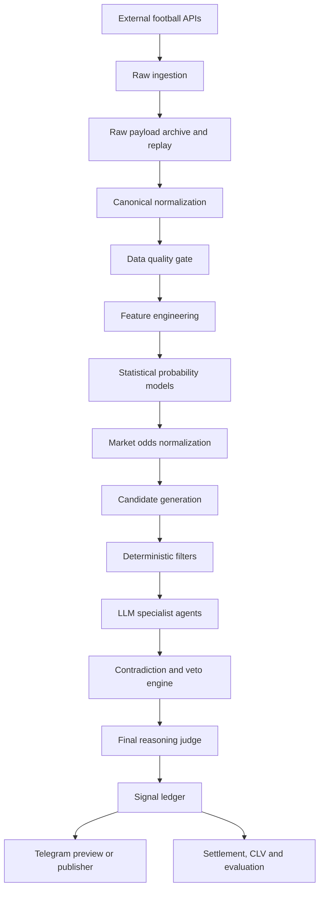
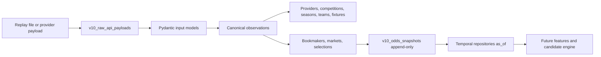
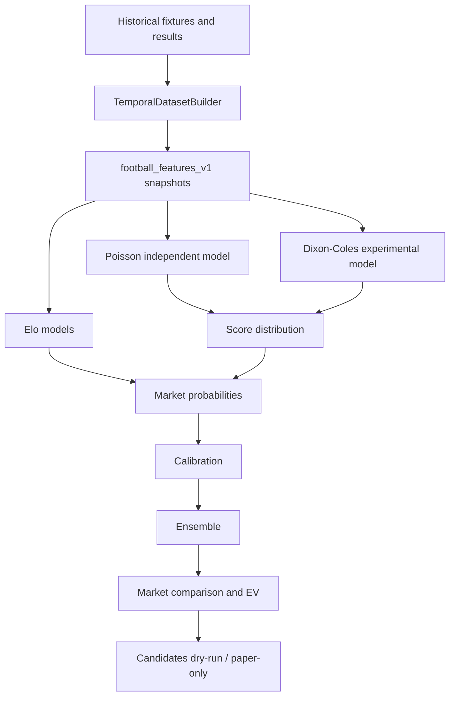
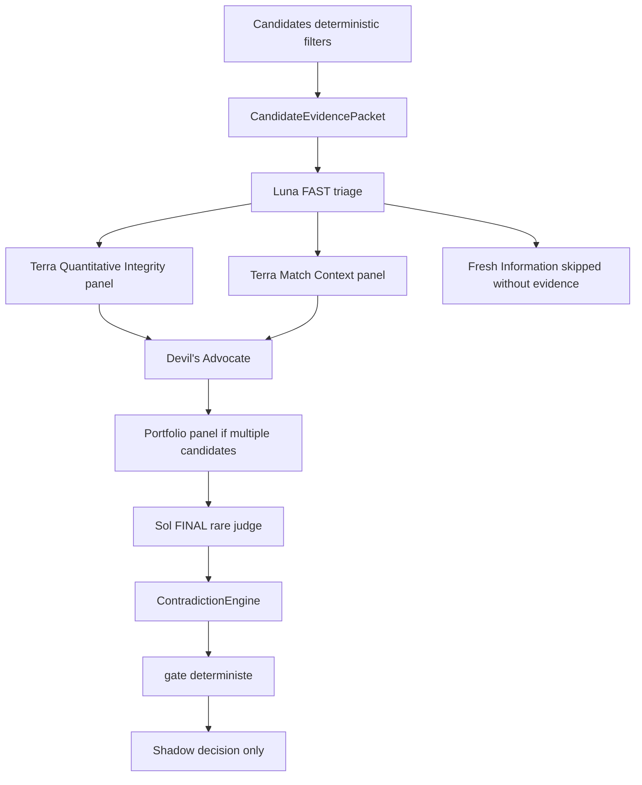
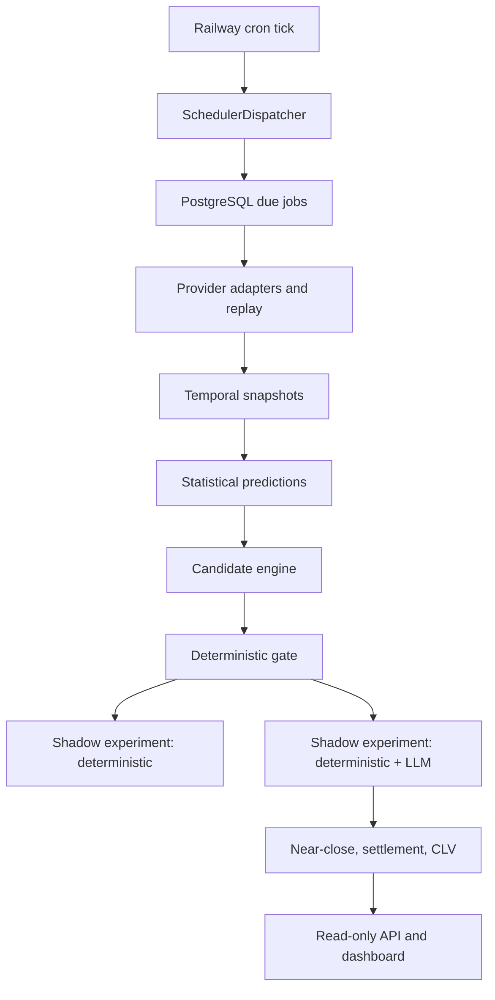

# Architecture V10

V10 separe la collecte, les calculs deterministes, les agents LLM et la publication.

## Frontieres

- `v10.odds` : cotes decimales, probabilites implicites, no-vig proportionnel, EV, CLV.
- `v10.data_quality` : statut PASS, PASS_WITH_WARNINGS, FAIL, STALE, CONFLICTING.
- `v10.candidates` : filtrage deterministe avant tout LLM.
- `v10.risk` : paper betting uniquement, caps conservateurs, aucune action bookmaker.
- `v10.settlement` : resultat officiel par marche, sans LLM.
- `v10.agents` : schema et mocks agents.
- `v10.final_judge` : juge deterministe de demo, refuse ou WATCH sans inventer.
- `app.py` : CLI additive, separee du `main.py` historique.

## Etat actuel

La couche V10 est additive et offline. La persistance relationnelle initiale est disponible sous `v10/db`, avec Alembic, repositories, replay provider et requetes temporelles. L'API interne, le scheduler distribue, les modeles statistiques reels et les agents LLM reels restent a construire dans les phases suivantes.

## Persistence Phase 2

Responsabilites :

- `v10.config` masque les secrets et refuse la configuration production dangereuse.
- `v10.db.models` declare les tables relationnelles V10 et les contraintes.
- `v10.db.repositories` concentre l'idempotence, les upserts et les requetes temporelles.
- `v10.replay.engine` stocke le raw payload puis reconstruit les entites canoniques.
- `v10.normalization` mappe API-Football et The Odds API depuis des payloads locaux.
- `v10.quality_db` reconstruit un rapport de qualite depuis la base.

## Statistical Engine Phase 3

Responsabilites :

- `v10.statistics.types` definit `TemporalContext`, fixtures historiques, rows dataset, distributions et predictions.
- `v10.statistics.dataset` construit les lignes d'apprentissage en ordre chronologique et exclut les donnees futures.
- `v10.statistics.features` genere forme, repos, H2H limite, Elo pre-match et missingness.
- `v10.statistics.elo`, `poisson` et `dixon_coles` produisent des probabilites sans LLM.
- `v10.statistics.markets` derive 1X2, double chance, draw no bet, totals et BTTS depuis la matrice de scores.
- `v10.statistics.calibration`, `ensemble` et `backtest` separent validation, combinaison et evaluation walk-forward.

Les tables Phase 3 `v10_model_versions`, `v10_feature_snapshots`, `v10_score_distributions`, `v10_statistical_predictions`, `v10_calibration_models` et `v10_evaluation_runs` permettent de versionner les predictions. Le chemin CLI reste additif: `app.py dataset`, `app.py model`, `app.py predict`, `app.py backtest` et `app.py demo statistical-end-to-end`.

## LLM Shadow Orchestration Phase 4

Luna filtre le volume avec reasoning low. Terra regroupe les roles compatibles en panels. Sol est reserve aux finalistes top K et ne modifie aucun chiffre deterministe. Le gate deterministe bloque toute ineligibilite, cote perimee, EV non positive, preuve invalide ou hard veto. Le mode par defaut reste `LLM_ENABLED=false`, `LLM_ALLOW_PAID_CALLS=false`, budgets a zero.
## V10 Phase 5 - Operations

Le web service `v10.api:app` est read-only. Le scheduler est un processus court, appele toutes les cinq minutes, qui quitte apres son tick. Aucun worker permanent ni Redis n'est requis dans cette phase.
