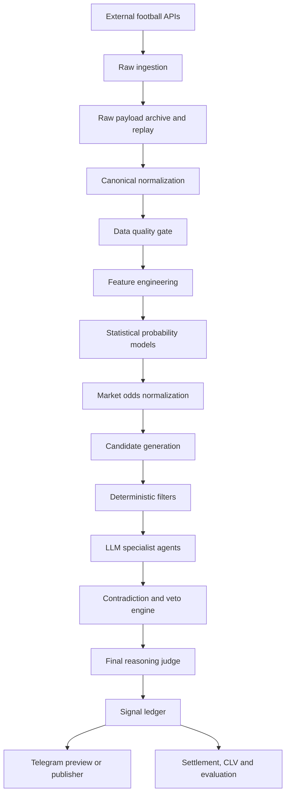
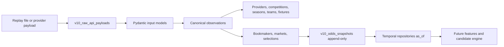

# Architecture V10

V10 separe la collecte, les calculs deterministes, les agents LLM et la publication.

## Frontieres

- `v10.odds` : cotes decimales, probabilites implicites, no-vig proportionnel, EV, CLV.
- `v10.data_quality` : statut PASS, PASS_WITH_WARNINGS, FAIL, STALE, CONFLICTING.
- `v10.candidates` : filtrage deterministe avant tout LLM.
- `v10.risk` : paper betting uniquement, caps conservateurs, aucune action bookmaker.
- `v10.settlement` : resultat officiel par marche, sans LLM.
- `v10.agents` : schema et mocks agents.
- `v10.final_judge` : juge deterministe de demo, refuse ou WATCH sans inventer.
- `app.py` : CLI additive, separee du `main.py` historique.

## Etat actuel

La couche V10 est additive et offline. La persistance relationnelle initiale est disponible sous `v10/db`, avec Alembic, repositories, replay provider et requetes temporelles. L'API interne, le scheduler distribue, les modeles statistiques reels et les agents LLM reels restent a construire dans les phases suivantes.

## Persistence Phase 2

Responsabilites :

- `v10.config` masque les secrets et refuse la configuration production dangereuse.
- `v10.db.models` declare les tables relationnelles V10 et les contraintes.
- `v10.db.repositories` concentre l'idempotence, les upserts et les requetes temporelles.
- `v10.replay.engine` stocke le raw payload puis reconstruit les entites canoniques.
- `v10.normalization` mappe API-Football et The Odds API depuis des payloads locaux.
- `v10.quality_db` reconstruit un rapport de qualite depuis la base.
