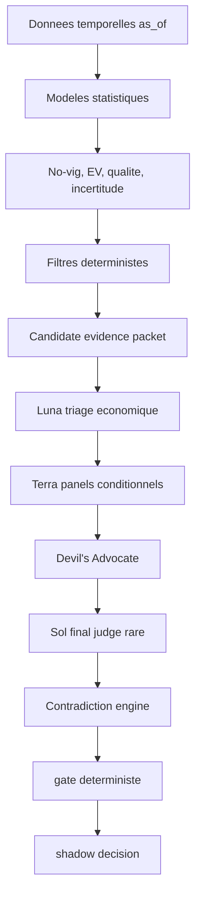

# Architecture LLM V10

La couche LLM V10 est shadow-only et additive.

## Responsabilites

- `v10.llm.config` : configuration fail-closed.
- `v10.llm.registry` : tiers logiques FAST, SPECIALIST, FINAL.
- `v10.llm.routing` : `ComplexityRouter` et escalade adaptee au dossier.
- `v10.llm.evidence` : preuves typees, packet compact, validation semantique.
- `v10.llm.providers` : mock, replay et OpenAI Responses dormant.
- `v10.llm.budgets` : reservations et reconciliation en `Decimal`.
- `v10.llm.cache` : cache metier par modele, prompt, schema et packet hash.
- `v10.llm.agents` : 12 roles logiques regroupables en panels.
- `v10.llm.contradictions` : hard veto non-LLM.
- `v10.llm.judge` : Sol review puis gate deterministe souverain.

Les LLM ne calculent jamais probabilites, cotes, EV, CLV, Kelly, ROI, score final ou mise.

