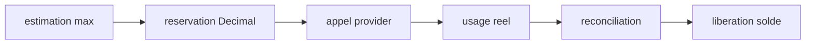

# Budgets LLM V10

Le budget manager fonctionne en fail-closed.

## Budgets

- journalier ;
- scan ;
- fixture ;
- candidat ;
- modele.

Processus :

Si le prix est inconnu, si le budget est nul ou si une reservation echoue, le systeme retourne `UNREVIEWED`, `WATCH` ou `NO_BET`, jamais une acceptation automatique.

## Cache

La cle de cache inclut provider, modele, reasoning, prompt version, schema, agent/panel, packet hash et tool policy.

Invalidation si :

- cote modifiee ;
- nouveau prompt ;
- nouvelle preuve ;
- nouvel `as_of` ;
- qualite modifiee ;
- modele ou reasoning change.

Les prix inclus dans `v10.llm.budgets.pricing` sont des placeholders configurables. Ils ne doivent pas etre interpretes comme tarifs officiels.

