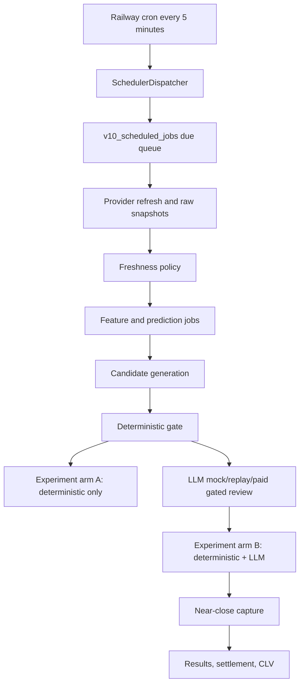

# Operational Shadow Pipeline

Le pipeline Phase 5 orchestre des scans prematch en shadow mode. Il ne publie rien, ne place aucune mise et ne modifie pas les probabilites calculees par Python.



Commandes utiles:

```powershell
python app.py fixtures discover --days 3 --dry-run
python app.py fixtures schedule --fixture-id <uuid> --dry-run
python app.py scan prematch --fixture-id <uuid> --mock-llm --dry-run
python app.py scan due --mock-llm --dry-run
python app.py demo operational-shadow-end-to-end --mock --json
```

Toutes les commandes persistantes requierent `--apply`.

