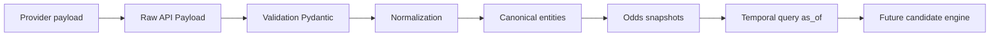

# Replay V10

Le replay V10 sert a reconstruire les entites canoniques depuis des payloads bruts deja observes, sans reseau et sans appel LLM.



## Commandes

Dry-run par defaut :

```powershell
python app.py replay provider --file tests/fixtures/providers/api_football/fixtures_sample.json --provider api_football --dry-run
python app.py replay provider --file tests/fixtures/providers/api_football/odds_sample.json --provider api_football --dry-run
```

Application explicite :

```powershell
python app.py replay provider --file tests/fixtures/providers/api_football/fixtures_sample.json --provider api_football --apply
python app.py replay provider --file tests/fixtures/providers/api_football/odds_sample.json --provider api_football --apply
```

Reconstruction depuis un run stocke :

```powershell
python app.py replay run --run-id <uuid>
```

Demo complete offline :

```powershell
python app.py demo postgres-end-to-end
python app.py demo postgres-end-to-end --json
```

## Providers supportes en Phase 2

- `api_football` fixtures ;
- `api_football` odds ;
- `the_odds_api` odds de replay local.

Les mappings utilisent uniquement les champs presents dans les fixtures locales de test. Toute donnee inconnue produit warning ou erreur, pas invention.

## Idempotence

Quatre empreintes sont separees :

- request fingerprint : provider + endpoint + parametres nettoyes ;
- raw payload content hash : JSON canonique trie, champs runtime documentes exclus ;
- canonical observation fingerprint : observation normalisee stable ;
- odds snapshot fingerprint : fixture + bookmaker + marche + selection + ligne + cote + observed_at.

Politique odds : une observation strictement identique au meme `observed_at` est ignoree ; la meme cote observee a un autre instant peut etre conservee ; une cote modifiee cree une nouvelle ligne.

## Sorties

Chaque replay indique :

- provider ;
- endpoint ;
- nombre de fixtures ;
- nombre de cotes ;
- raw payload cree ou deduplique ;
- lignes inserees, mises a jour, ignorees, echouees ;
- `lab_only=true` ;
- `can_influence_picks=false`.
