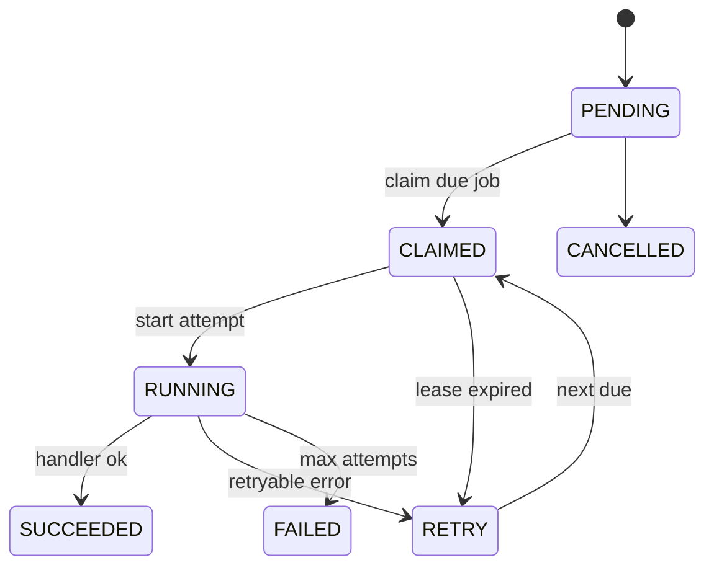

# Scheduler Dispatcher

Le scheduler Phase 5 est un dispatcher court, concu pour un cron Railway toutes les cinq minutes.



Principes:

- advisory lock global court;
- `FOR UPDATE SKIP LOCKED` sur PostgreSQL;
- fallback SQLite pour tests;
- leases avec expiration;
- retry avec backoff;
- arret avant `SCHEDULER_SHUTDOWN_MARGIN_SECONDS`;
- aucune boucle infinie.

Commandes:

```powershell
python app.py scheduler tick --dry-run
python app.py scheduler tick --max-runtime-seconds 240 --max-jobs 50
python app.py scheduler status
python app.py scheduler due
python app.py scheduler recover-leases --dry-run
```

