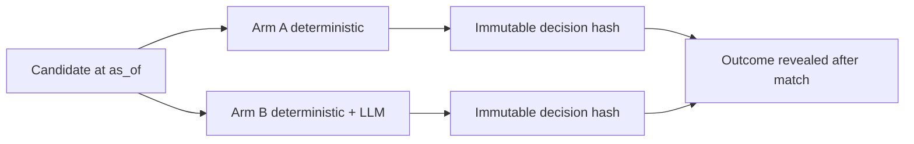

# Shadow Experiment

Experience permanente: `statistical_vs_llm_shadow_v1`.

Deux bras sont crees pour le meme candidat au meme `as_of`:

- `deterministic_only`;
- `deterministic_plus_llm`.

Regles:

- decisions immuables;
- outcome cache jusqu'apres match;
- aucune exclusion retroactive;
- cohort rules preregistered;
- resultats evalues uniquement en paper betting;
- `STATISTICAL_MODEL_VALIDATED_FOR_SIGNALS=false` bloque toute interpretation operationnelle reelle.

