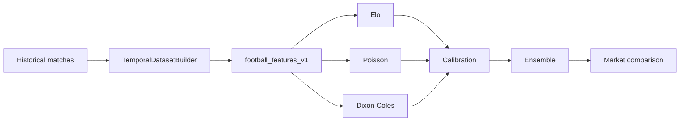

# Statistical Models V10

Les modeles V10 sont deterministes et fonctionnent sans LLM.

Pipeline :

Marches derives :

- `match_winner` : home/draw/away.
- `double_chance` : 1x/12/x2.
- `draw_no_bet` : home/away/push.
- `over_under_1_5`, `over_under_2_5`, `over_under_3_5`.
- `both_teams_to_score`.

Limites :

- pas de LLM ;
- pas de garantie de ROI ;
- pas d'activation automatique ;
- pas de donnees post-match comme features pre-match.
