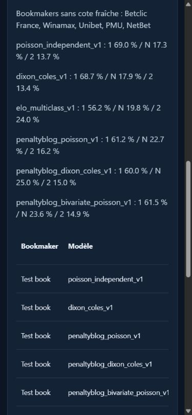

# ORACLE V11 — mission 2, preuves et limites

## Verdict

**PASS pour la publication et le parcours logiciel hors réseau, BLOCKED pour les bookmakers live et l'hébergement réel.** Le code est publié uniquement sur `codex/oracle-v11-safe-integration`, avec une [PR brouillon nº 5](https://github.com/galaxie667petasse-oss/oracle-bot-/pull/5). Aucune fusion dans main, mise réelle, publication Telegram, souscription ou exposition publique du site.

La CI réelle [38799674700](https://github.com/galaxie667petasse-oss/oracle-bot-/actions/runs/38799674700) est **SUCCESS** sur `8176a1e785e0a3c94e7417130eae6120a6f5f75b`. Ses trois jobs `offline`, `v11` et `v11-container` sont réussis. Les résultats des derniers commits documentaires/de protection se consultent dans [les exécutions de la branche](https://github.com/galaxie667petasse-oss/oracle-bot-/actions?query=branch%3Acodex%2Foracle-v11-safe-integration) ; la réponse de fin de mission donne le SHA final et son workflow exact.

## Phase 1 — protection et publication : PASS

Le checkout a été repris propre au SHA local annoncé `3067e9c`. Le dépôt distant est public et sa branche V11 pointait encore vers `e565b243`. Les neuf commits et leurs 35 versions de fichiers modifiés ont été contrôlés. Le scan existant n'a trouvé aucun secret ; la revue de publication a trouvé des chemins contenant un profil Windows dans deux documents et dans leurs versions intermédiaires.

Le push a été suspendu. Après autorisation explicite de l'utilisateur, les neuf commits non publiés ont été reconstruits en retirant ces seuls chemins, sans changer le code ni les auteurs/dates. Les versions originales restent intégralement récupérables dans les bundles locaux vérifiés, dont `mission2-start.bundle`. La comparaison entre l'ancien et le nouvel état final ne change que deux lignes documentaires. Aucun force-push, reset, suppression de branche ou modification d'une branche historique.

Le push normal `e565b243 → 97d0b7a` a réussi et le SHA distant a été vérifié. Les commits fonctionnels ultérieurs sont ajoutés normalement. Le contrôle de publication parcourt chaque version de fichier de la plage Git, et pas uniquement l'arbre final. Les images synthétiques ont été vérifiées visuellement et leurs métadonnées ne contiennent pas d'EXIF ; l'ancienne capture nommée `.png` est en fait un JPEG, conservé comme artefact historique. La nouvelle capture utilise l'extension `.jpg` correcte.

| SHA local original conservé en sauvegarde | SHA public assaini |
|---|---|
| `e3ae4ca` | `0e38e22` |
| `3f691be` | `246d770` |
| `926be2e` | `989cfc3` |
| `ba3a565` | `d57bb61` |
| `db73b84` | `e16aecb` |
| `2678e6c` | `3e404b8` |
| `3ffd891` | `68fbc0e` |
| `eccbba2` | `b93d602` |
| `3067e9c` | `97d0b7a` |

Le scanner est heuristique et complète la revue humaine ; il ne constitue pas une preuve mathématique d'absence de tout secret. Les bases, payloads réels, fichiers `.env`, archives, bundles et journaux locaux restent hors Git. Le contexte Docker exclut également bases, logs, archives et configuration odds locale.

## Phase 2 — CI complète : PASS sur le SHA vérifié

| Contrôle | Preuve réellement exécutée |
|---|---|
| Point de départ Windows/Python 3.12.15 | 84 tests réussis : 49 V11 + 35 V10, avant changements de mission 2 |
| V11 finalisé, sécurité et résultats, local | 52 tests réussis : 49 existants + 3 de mission 2 ; les tests ciblés modifiés ont été rejoués |
| V11 Linux et PostgreSQL réel | **53 passed, 11 warnings**, aucun skip dans le [job 116645123628](https://github.com/galaxie667petasse-oss/oracle-bot-/actions/runs/38799674700/job/116645123628) |
| PostgreSQL | Serveur **16.15** attesté par les logs ; test exigeant `SELECT version()` PostgreSQL, sans fallback SQLite ; migrations jusqu'à `20260719_0004`, cache persistant, quota et verrou exclusif inter-sessions |
| V10 / historiques | [job offline 116645123269](https://github.com/galaxie667petasse-oss/oracle-bot-/actions/runs/38799674700/job/116645123269) réussi : cinq suites V10, 122 scripts historiques, replays et smokes, PostgreSQL réel et migrations |
| Temporel / anti-lookahead | Séparation entraînement/calibration/test, embargo et fixtures simultanées ; changement d'un résultat du fold test sans changement des prévisions de ce fold ; comparaisons marché sur matchs identiques |
| Immutabilité / restauration | Triggers UPDATE/DELETE, événements séparés, idempotence et réouverture d'une sauvegarde avec données, assertions sur l'historique |
| Dépendances | Lock exact Python 3.12 utilisé sous Windows et Linux, `pip check` réussi ; pas de dépendance ajoutée sans version dans le build V11 |
| Docker V11 | [job 116645718557](https://github.com/galaxie667petasse-oss/oracle-bot-/actions/runs/38799674700/job/116645718557) réussi : build, démarrage non root, racine en lecture seule, volume nommé, authentification, absence des routes V10 dans l'application privée |
| Persistance conteneur | Historique identique après redémarrage ; copie du ledger rouverte et vérifiée : intégrité `ok`, références valides, hashes valides et une prédiction conservée |
| Publication / secrets | Audit des versions Git en CI, scanner de secrets et contrôle manuel ; absence de données locales dans les nouveaux fichiers suivis |

Les avertissements de dépendances ne sont pas masqués : Starlette/httpx, penaltyblog/NumPy et, dans certains ordres d'import locaux, matplotlib/pyparsing. Ils sont des dépréciations, pas des échecs corrigés par suppression de tests. Le nombre peut dépendre des imports effectués avant la capture des warnings.

La CI sur PR s'exécute sur un commit de fusion technique GitHub (`9fe0e006…` dans ce run), tandis que son `head_sha` attesté est le commit source `8176a1e…`. Ce mécanisme de test n'est pas une fusion dans main. Le workflow push correspondant est [38799665684](https://github.com/galaxie667petasse-oss/oracle-bot-/actions/runs/38799665684).

Les résultats et étapes CI ont été conservés dans les logs GitHub, ainsi que localement dans `variable/mission2/` : mapping des commits, métadonnées de run et logs des jobs PostgreSQL/V11 et conteneur. Les XML JUnit sont conservés comme artefacts CI ; aucun payload fournisseur réel ni secret n'y est injecté.

## Phase 3 — vraies API : BLOCKED

Les clés API-Football et The Odds API sont absentes des scopes Process/User/Machine inspectés ; aucun `.env` local n'a été détecté dans les deux checkouts. Les éventuels secrets stockés sur GitHub ne sont pas révélables par cette inspection. La CI hors réseau n'utilise aucun secret fournisseur réel.

Les adaptateurs existants ont été inspectés avant extension et restent réutilisés. Les instructions exactes de saisie sécurisée, de configuration GitHub et de probe borné sont dans [V11_PRIVATE_SETUP.md](V11_PRIVATE_SETUP.md). Aucun résultat API n'a été inventé ; aucun crédit consommé ni abonnement acheté.

Restent à mesurer sur vraies réponses : rencontres pré-match, présence de chaque bookmaker FR, marchés disponibles, timestamps et âge des cotes, coût et quota réellement déclarés. Le plafond reste 15 € TTC/mois ; une offre payante ne sera pas souscrite sans autorisation.

## Phase 4 — intégrations : PASS logiciel / PARTIAL métier

Fichiers modifiés ou ajoutés :

- `v11/api.py`, `mobile.html`, `mobile.js`, `mobile.css` : les trois modèles penaltyblog sont raccordés au web, activables par case, avec les trois baselines V10 toujours conservées. Les erreurs de modèle sont affichées, sans remplacer une sortie invalide par une probabilité inventée.
- `v11/service.py` : bookmakers FR sans cote fraîche listés explicitement. Un bookmaker absent n'est pas fabriqué. L'analyse conserve la provenance, les probabilités, cotes, versions, motifs et dates dans le ledger.
- Le 1N2 Elo dispose aussi de son EV `p × cote − 1`, sans lui inventer une grille de scores ni le rendre compatible avec les marchés de buts/handicap qu'il ne modélise pas. Le test conteneur renforcé par `8cf537e` exige les six modèles et dix-huit comparaisons 1N2 sur données synthétiques ; sa preuve CI est distincte du premier contrôle de démarrage.
- `v11/results.py`, `ledger.py`, `__main__.py` : récupération d'un fichier de résultats réellement collecté et application via mapping explicite ; identité des équipes et kickoff vérifiés avant écriture, FT réglementaire uniquement, réexécution idempotente et résultats ajoutés séparément des prédictions.
- `evaluate --quotes-file` : les archives de cotes peuvent alimenter la comparaison statistique depuis la CLI, en conservant la provenance et les identifiants exacts.
- `/api/v11/performance` : simulation hypothétique authentifiée ; aucune performance publiée comme réelle, ROI nul au sens `null` quand il manque des résultats.

La consolidation API-Football/The Odds API existante reste en place avec mappings explicites et dates de collecte non antidatées. Le suivi web affiche le calcul en cours, les erreurs, les données manquantes et l'historique ; il ne s'agit pas d'une file persistante de jobs asynchrones. La collecte périodique, un ensemble validé et les statistiques enrichies ne sont pas présentés comme terminés.

Les règlements des marchés supplémentaires sont testés, mais leur collecte réseau reste limitée au 1N2 tant que la couverture fournisseur réelle n'est pas observée. Aucune recommandation : `ABSTAIN`, `can_influence_picks=false` partout.

## Phase 5 — site réel : PARTIAL

Le conteneur démarre et conserve son ledger sur Linux en CI, indépendamment de l'ordinateur personnel. `compose.v11.yml` prépare un port loopback, un volume persistant et les restrictions système. L'application privée sert V11 seul ; la V10 conserve son propre point d'entrée et ses modules.

Authentification Bearer obligatoire, absence de jeton refusée, en-têtes `no-store` sur données/erreurs, `nosniff`, CSP sans inline JS/CSS, pas de docs OpenAPI exposées par l'application privée. Les assets ne contiennent pas de données ni de secrets ; le jeton du navigateur ne va pas dans le stockage persistant.

Navigateur réel local : calcul des six modèles sur un match **synthétique**, clés absentes affichées, cinq bookmakers manquants affichés, historique visible, mauvaise clé refusée avec effacement des résultats précédents, date sans données sans match inventé. Viewport de téléphone 390 px : document de 375 px, aucun débordement horizontal de la page ; le tableau peut défiler dans son conteneur. Aucune erreur JavaScript constatée sur ce parcours.

L'accès depuis un téléphone physique, le TLS/ACL privés sur hébergeur, la disponibilité durable et la reprise sur une autre machine restent **NOT TESTED**. Aucun service distant n'est déployé. L'architecture et les procédures sont dans le guide privé ; aucun tarif d'hébergement n'est affirmé sans devis vérifié.

## Phase 6 — statut final par frontière

| Frontière | Statut |
|---|---|
| Publication branche V11, PR brouillon, sauvegardes originales | PASS |
| Tests mathématiques, temporels, sécurité, immutabilité, V10 et historiques | PASS sur les SHA/CI indiqués |
| PostgreSQL réel et migrations en CI | PASS |
| Build/démarrage V11, auth, persistance après redémarrage et copie rouverte | PASS |
| Interface locale et viewport mobile | PASS sur données synthétiques |
| Modèles exécutables et intégrations hors réseau | PASS |
| Validation prédictive réelle, rentabilité et CLV réelle | BLOCKED par absence d'archives pré-match probantes et de volume prospectif suffisant |
| Bookmakers live, crédits réels et autres marchés réseau | BLOCKED par absence de clés accessibles et de réponses observées |
| Hébergement privé durable | BLOCKED par choix/autorisation et accès à l'infrastructure |
| Téléphone physique, TLS/ACL réels, reprise hors machine | NOT TESTED |

Dernières actions nécessaires : configurer les clés par un canal sécurisé, réaliser le probe borné et enregistrer sa vraie couverture ; accumuler des prédictions prospectives ; choisir et autoriser l'hôte privé ; vérifier téléphone, TLS, ACL et reprise hors machine. Les anciennes données et modules restent conservés. Le projet n'est pas annoncé comme entièrement opérationnel.

