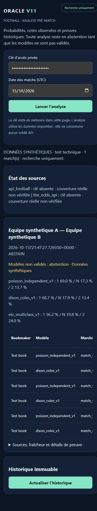

# ORACLE V11 — bilan vérifié du 15 octobre 2026

**Archive de la mission 1, avant publication.** Pour l'état actuel, consulter [le bilan de mission 2](V11_MISSION2.md). Les SHA listés ci-dessous sont les SHA locaux originaux, conservés en sauvegarde ; la mission 2 documente leur correspondance avec les commits publics assainis.

## Verdict

**Développement local fonctionnel en recherche, validation live incomplète.** Le parcours sources normalisées → historique disponible → modèles → cotes/EV → prédiction scellée → événement résultat → consultation et simulation est testé hors réseau. L'interface est vérifiée dans le navigateur, y compris en viewport téléphone. Ce résultat ne constitue ni une validation de stratégie ni un parcours live avec bookmakers.

Les décisions restent `ABSTAIN` et `can_influence_picks=false`. Aucun abonnement, mise réelle, envoi Telegram, push, publication ou déploiement n'a été réalisé.

## Protection et point de départ

- Branche de travail isolée : `codex/oracle-v11-safe-integration`, dans `oracle-v11`.
- Base vérifiée : `e565b2438269561f40970c5debe3a13be05facf7`.
- [CI de la base 38776566962](https://github.com/galaxie667petasse-oss/oracle-bot-/actions/runs/38776566962) : `completed/success`, SHA confirmé par API GitHub. Cette CI précède les commits ci-dessous.
- Ancien checkout avec travaux Phase 4 conservé sur sa branche originale ; comparaison SHA-256 des **1 930 fichiers** du manifeste après développement : **aucun fichier modifié**.
- Deux bundles Git vérifiés, archive locale de l'état de travail contrôlée par CRC, sauvegardes SQLite intègres. Détails et restauration dans `ORACLE_PROJECT_MAP.md`.

## Avancement par phase

| Phase | Réalisé et fichiers | Preuves | Limites et suite |
|---|---|---|---|
| 0 — Audit/protection | `ORACLE_PROJECT_MAP.md`, sauvegardes hors dépôt, inspection branches/remotes/HEAD/status et CI | bundle verify, ZIP CRC, SQLite integrity, manifeste des 1 930 fichiers inchangé | sauvegarde hors machine encore à prévoir ; aucune restauration destructive effectuée |
| 1 — Données | `v11/contracts.py`, `sources.py`, `__main__.py` ; réemploi des normaliseurs fixtures/résultats/odds V10, cache/quota/verrou SQLAlchemy ; cinq clés FR explicites ; consolidation via mapping vérifié | transports simulés, cache sans requête supplémentaire, HTTP 429, refus sans clé, timestamps de marché conservateurs, lignes préservées, consolidation de payloads jusqu'aux modèles et CLI | **aucune API live vérifiée**, clés absentes ; statistiques enrichies, collecte des autres marchés et orchestration périodique à raccorder |
| 2 — Modèles | `v11/models.py`, `evaluation.py`, `requirements-v11.txt`, lock Windows Python 3.12 ; V10 Poisson/DC/Elo conservés ; vrais modèles penaltyblog Poisson/DC/bivarié ; calibration sur partition distincte, baseline marché | bibliothèque 1.6.2 exécutée pour les trois modèles ; six modèles exécutés sur l'archive réelle locale ; comparaison appariée au marché testée sur données synthétiques | aucun modèle promu ; pas d'ensemble activé ; performances temporelles réelles non établies ; incertitude individuelle affichée comme non estimée |
| 3 — Marchés | `v11/markets.py` : 1N2, double chance, DNB, totals, BTTS, exact score, AH avec lignes quart ; règlement et EV intégrés sur la grille | victoire/perte/push/demi-gain/demi-perte, complémentarité AH et EV binaire, rejet de lignes invalides et de statuts non réglementaires | collecte réseau actuelle limitée au 1N2 ; autres cotes importables, couverture réelle inconnue |
| 4 — Historique/preuves | `v11/ledger.py`, `evaluation.py`, `paper.py` : snapshots et prédictions immuables, résultats séparés, calibration chronologique, Brier/log-loss/bins, bootstrap par jour, simulation ROI/CLV conditionnelle | triggers UPDATE/DELETE, idempotence, sauvegarde/restauration avec contenu, refus du mélange synthétique/réel, invariance des prévisions au changement d'un résultat du même fold de test | pas de backtest temporel réel ni de CLV réelle avec l'archive actuelle ; mapping des archives de cotes accessible par API Python, pas encore par la CLI d'évaluation ; aucune preuve absolue d'absence de fuite sur des sources externes |
| 5 — Web mobile | `v11/api.py`, `mobile.html`, montage additif `v10/api.py`, `Dockerfile.v11` ; date UTC, analyse, probabilités, cotes/EV, incertitude, abstentions, sources, historique | API authentifiée et parcours import/analyse/historique testés ; navigateur réel ; viewport 390 px ; largeur du document 375 px, tableau défilant dans son conteneur | téléphone physique et accès privé distant non testés ; penaltyblog activable par la CLI, pas par un bouton web ; import/résultats via CLI/API plutôt que formulaires web ; hébergement seulement préparé |
| 6 — Validation | `tests/test_v11.py`, job CI V11, `scripts/v11_archive_smoke.py`, contrôles existants, lock de l'environnement | résultats détaillés ci-dessous | nouvelle CI distante non exécutée ; Docker et PostgreSQL réels non disponibles localement ; aucune livraison publique |

## Tests effectivement exécutés

Environnement principal final : Python **3.12.15**, environnement **isolé** `.venv312`, installation de `requirements.txt` et `requirements-v11.txt` réussie. Versions enregistrées dans `requirements-v11-windows-py312.lock.txt` ; `pip check` : **No broken requirements found**.

| Commande / contrôle | Résultat |
|---|---|
| `python -m pytest tests/test_v11.py -q` sur le code final | **49 passed, 5 warnings**, aucun skip |
| cinq suites `test_v10_{foundation,persistence,statistics,llm,operations}.py` | **35 passed** ; passage combiné intermédiaire V11/V10 : 83 passed avant l'ajout du dernier test de consolidation |
| chaque `test_*.py` historique exécuté comme script sous Python 3.12 | **122 scripts réussis, 0 échec** |
| même boucle historique initiale sous Python 3.14 | 122 scripts réussis ; contrôle complémentaire, environnement hérité |
| replay fournisseur API-Football `--dry-run` | exit 0, payload de test |
| `app.py demo statistical-end-to-end --json` | exit 0, synthétique |
| `app.py demo operational-shadow-end-to-end --mock --json` | exit 0, mock |
| `app.py demo postgres-end-to-end --json --database-url sqlite:///variable/v11-regression.sqlite3` | exit 0, **SQLite** malgré le nom de la commande ; pas une preuve PostgreSQL |
| migrations de la base de cache isolée V10 | upgrade des quatre révisions jusqu'à `20260719_0004`, validé dans un test CLI |
| ledger V11 status/backup et restauration dans les tests | intégrité, clés étrangères et hashes réussis ; sauvegarde/restauration testée avec prédiction et résultat |
| `scripts/secret_scan.py --root .` | 0 fichier problématique |
| `compileall` V10/V11 et script d'archive | exit 0 |
| `project_audit.py --no-imports --no-git` | aucune erreur bloquante ; options limitant explicitement cet audit |
| `git diff --check` | aucune erreur de whitespace |

Les cinq avertissements du dernier test V11 proviennent de dépendances : Starlette recommande `httpx2` pour son TestClient ; penaltyblog 1.6.2 utilise une affectation de forme de tableau dépréciée avec NumPy 2.5. Ils ne sont pas filtrés. L'environnement est verrouillé pour rendre ces résultats reproductibles ; une montée de version nécessite une nouvelle validation.

Un premier test appelait à tort `synthetic_matches(160)` alors que l'API existante ne prend pas d'argument : le test a été corrigé. Le jeu synthétique V10 régulier a aussi révélé une grille Dixon-Coles négative avec penaltyblog : elle reste refusée, et ce cas est conservé dans `test_degenerate_dixon_coles_grid_is_rejected`. Les tests positifs des trois bibliothèques utilisent un autre jeu synthétique, varié et déterministe. Aucun test en échec n'a été retiré pour obtenir un statut vert.

Les journaux détaillés locaux sont conservés dans `variable/historical-validation-py312/`, `variable/py312-smokes/` et `variable/archive-smoke-py312.json`. Ils restent hors Git. Les tests ne constituent pas un échantillon de performance financière.

## Données réelles et données simulées

**Réellement vérifié :** identité Git/GitHub et CI de base ; fichiers persistants/sauvegardes ; vrai code penaltyblog ; lecture de l'archive réelle `..\oracle-bot-\data\Matches.csv` ; calcul des six modèles sur un sous-ensemble de cette archive ; interface dans un vrai navigateur local.

Archive : 500 lignes chargées, compétition initiale F1, 53 résultats antérieurs utilisables pour le smoke de cette compétition. Les six calculs réussissent. SHA-256 avant/après identique : `6905ca5324df95282fefcdc2b320caed40745254055f38a3e5a768b8a073ec2b`.

Ce smoke n'est **pas** une mesure de fiabilité : pas de timestamps de disponibilité des résultats/cotes, pas d'archive pré-match vérifiable, pas de test statistique sur cet échantillon. Le chargeur V10 reconstruit `observed_at` depuis la date du match ; V11 ne reprend pas cette reconstruction comme preuve temporelle. ROI et CLV de cette archive restent `null`.

**Simulé uniquement :** réponses HTTP fournisseurs dans les tests, scores/odds d'intégration, backtests chronologiques de validation du logiciel, ROI/CLV de test, import et analyse du match synthétique affiché dans le navigateur. Les modèles mathématiques exécutés dans ces tests sont réels, leurs données sportives sont synthétiques.

La documentation [The Odds API bookmakers](https://the-odds-api.com/sports-odds-data/bookmaker-apis.html) liste les cinq clés FR utilisées. Leur couverture par date, ligue et marché doit encore être constatée dans des réponses authentiques. Aucune clé n'était disponible dans l'environnement et aucune configuration locale contenant une clé n'a été détectée.

## Commits locaux

| Commit | Objet |
|---|---|
| `e3ae4ca` | carte du projet et préservation — phase 0 |
| `3f691be` | contrats, modèles, marchés, ledger, analyse, évaluation, simulation — phases 2–4 |
| `926be2e` | collecte bornée, cache/quota V10 et CLI — phase 1 |
| `ba3a565` | refus des doublons et fraîcheur conservatrice — phases 1/3 |
| `db73b84` | interface FastAPI authentifiée et Dockerfile dédié — phase 5 |
| `2678e6c` | tests, job CI V11 et smoke d'archive — phase 6 |
| `3ffd891` | contrôle temporel apparié, statut calibration et lock Python 3.12 — phases 2/4/6 |
| `eccbba2` | consolidation de résultats observés et mapping explicite — phases 1/4 |

Le commit documentaire final ajoute ce bilan, le runbook et la capture ; son SHA se consulte avec `git log -1`. Aucun de ces commits n'a été poussé. La branche historique et `main` n'ont pas été modifiées.

## Étapes restantes

1. Fournir les clés via le mécanisme sécurisé de l'environnement, vérifier l'offre gratuite et les quotas, puis effectuer des requêtes bornées pour mesurer réellement la couverture des cinq bookmakers.
2. Constituer des snapshots réels avec résultats collectés et mappings vérifiés ; automatiser ensuite l'alimentation périodique, les statistiques enrichies et les marchés supplémentaires sur preuve de couverture.
3. Accumuler des prédictions scellées pré-match, résultats et cotes de clôture. Produire ensuite un backtest temporel et une comparaison marché sur une population suffisante, sans promouvoir un modèle sur le smoke de 53 matchs.
4. Vérifier le nouveau job CI sur GitHub après une publication autorisée des commits ; exécuter Docker et PostgreSQL dans un environnement disponible.
5. Choisir et autoriser l'hébergement privé ; vérifier les secrets, le volume persistant, la restauration hors machine et un véritable téléphone. Aucun déploiement public sans autorisation.

